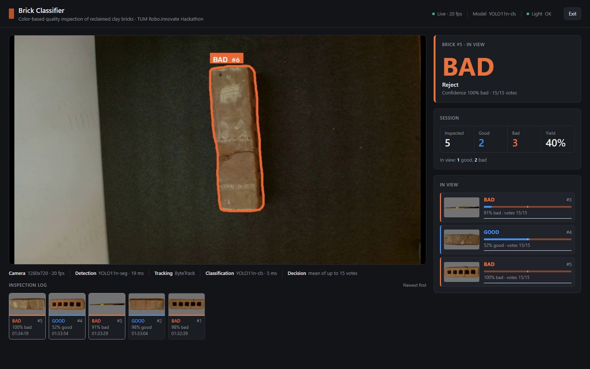

# robo.innovate Hackathon 2026 — Marmon challenge

**Reclaimed clay bricks are sorted by hand. We built the pieces to automate it:** a camera that
decides whether a brick is reusable, a robot arm that picks and stacks it, and a factory
simulation that shows how the whole line would run.

Three days at the Technical University of Munich, three tasks, a team of four. This repository
collects the working result of each task in one place.



*Task 1 running live: every brick in view gets an id, a verdict and a confidence, and the panel keeps the running yield of the session.*

---

## The three tasks

| | What it does | Folder | Author |
|---|---|---|---|
| **Task 1** | Decides **good or bad** for each brick from its color, live on camera | [`task1-brick-classifier/`](task1-brick-classifier/) | **Daniel Alipázaga Lazo** |
| **Task 2** | Teaches a **Franka arm** to pick and stack bricks, with deterministic motion | [`task2-franka-manipulation/`](task2-franka-manipulation/) | ns-235861 |
| **Task 3** | Simulates the **factory line**, from material flow to a browser replay | [`task3-factory-simulation/`](task3-factory-simulation/) | JhannoxDev |
| **Extra** | Perception and planning **experiments** in Isaac Sim for the sorting cell | [`simulation-experiments/`](simulation-experiments/) | Programmercloud-cmd |

The four of us collaborated across all the tasks; the author column says who wrote the code in
each folder. Published here with the team's agreement. See [AUTHORS.md](AUTHORS.md).

---

## Task 1 — Brick Classifier

The task I owned. A camera looks at reclaimed clay bricks and sorts them into **reusable** and
**reject** by color alone, live, with the result shown in a browser.

Under- and overfired bricks look different from good ones, but the hard part is that bad bricks
sit on **both sides** of the good ones: some darker, some lighter. A single threshold cannot
separate them.

### How it works

```
Camera (Orbbec Gemini 2, 720p)
  → YOLO11n-seg          box + mask for every brick          19 ms
  → ByteTrack            one stable id per brick across frames
  → YOLO11n-cls          classifies the masked crop only      5 ms
  → vote                 mean of the last 15 frames  →  GOOD / BAD
```

Masking matters: the network sees only the brick, with the table greyed out, and it trains
**without color augmentation**, because color is the signal rather than noise.

### How it was built

1. **Label without training anything.** Grounding DINO → row split → MobileSAM segmented the
   bricks with zero training, but took ~1.2 s per frame. Too slow to run live, good enough to
   label automatically.
2. **Distil it into something fast.** Those automatic labels trained a YOLO11n-seg detector that
   runs at ~17 ms per frame on an RTX 3050, which is what makes live tracking possible.
3. **Try hand-made color rules first.** A calibrated 1-NN in CIELAB reached 91–93 % on the same
   bricks. A relative lightness band collapsed to 53 % when the light moved by 4–5 L\*. That
   failure is what pointed at the real risk: light, not color.
4. **Then a small network**, trained on the masked crop, which held up when the light changed.

### Measured results

| What was measured | Result |
|---|---|
| Detector v3, validation bricks found | **190 / 190**, 1 false detection, mask IoU 0.95–0.98 |
| Detector v3 on overexposed wood | **40 / 40** correct (v2: 6 / 40) |
| Detector v3 on an empty table | **0** false detections (v2: 3) |
| Network, same bricks under an unseen light | **114 / 133 = 86 %** |
| Reference run of the web demo | every brick right, ~22 fps on a laptop RTX 3050 |
| **Network, bricks never seen before** | **40 / 74 = 54 %** |

That last row is the honest one. We had **only 10 physical bricks**, so the network learned
*those* bricks rather than brick quality in general. The next step is more bricks, not more
photos of the same ones.

Every number traces back to a file under [`task1-brick-classifier/results/`](task1-brick-classifier/results/);
[`PITCH_NOTES.md`](task1-brick-classifier/PITCH_NOTES.md) says which one.

### Run it

```bash
cd task1-brick-classifier
pip install -r requirements.txt          # install torch for your CUDA first
python scripts/web_demo.py --classifier nn \
  --reference examples/calibration_20261026_171541_demo.json
# open http://localhost:8000     p = presentation mode, o = operator panel
```

The model weights are **not** in this repository: they make every clone heavy and they are
reproducible from the scripts. Pass your own with `--weights` and `--nn-weights`, or ask the
team. Full options in [`scripts/README.md`](task1-brick-classifier/scripts/README.md), and the
Jetson Orin Nano deployment in [`jetson/README.md`](task1-brick-classifier/jetson/README.md).

### Things that only show up when you build it

- **15 votes, not 5.** A quick 5-vote lock froze the verdict while a hand was still moving the
  brick into place.
- **Detect on the full frame, zoom only the video.** Cropping before detection made bricks look
  2–4× larger than in training and accuracy fell from 35/35 to 30/35, and to 5/35 for tight
  areas. Detecting on the whole frame and filtering afterwards restored 35/35.
- **A camera swap is a recalibration.** The Gemini 2 sees color differently from the C920 the
  network trained on, so the demo keeps the validated network and warns when the table lightness
  drifts away from the calibration.

---

## Task 2 — Franka manipulation

Teaching a Franka arm the positions of a brick stack and moving between them deterministically,
with no inferred poses: every target is either measured by hand or derived from measured anchors
on a fitted grid.

Motion runs as one continuous quintic Bézier arc with vertical endpoint tangents, keeping
position, velocity and acceleration continuous. Endpoint errors above 1 mm or 1°, callback gaps,
joint bounds and envelope violations all stop the motion. A second folder holds a ROS 2 reference
stack for the same cell: hand-eye calibration, a LEGO sorter and the block-by-block decisions
behind it.

[`task2-franka-manipulation/`](task2-franka-manipulation/) · written by ns-235861

## Task 3 — Factory simulation

An offline model of the production line that replays in a WebGL browser with no server, no GPU
machine and no extra packages. The validator checks material conservation, pallet identity, mixed
recipes in three dimensions, category-specific orders, rejection interlocks and synchronized
layer transfers. It also carries the Unreal exploration assets and the handoff tooling.

[`task3-factory-simulation/`](task3-factory-simulation/) · written by JhannoxDev

## Extra — Simulation experiments

Dated experiments bringing the real control stack and an Isaac Sim backend into agreement:
depth-guided grasp candidates, pose readers, material binding and declared-material retention.
Each folder keeps its README and its script so the experiment can be rerun.

[`simulation-experiments/`](simulation-experiments/) · written by Programmercloud-cmd

---

## What is in this repository, and what is not

This is a **curated** copy, meant to be readable and quick to clone, not a mirror of the team's
working repositories.

**Kept:** all source code, all documentation, the metrics behind every claim, and a sample of the
result images.

**Left out:** trained model weights, image datasets, recorded replay packages, per-move robot
logs and generated data files of tens of megabytes. Together they were over 1.2 GB; the whole
repository is now about 21 MB.

Nothing was rewritten to look better. Where a result is weak, such as 54 % on unseen bricks, it is
reported as it was measured.

## Repository structure

```text
.
├── task1-brick-classifier/        Daniel Alipázaga Lazo
│   ├── README.md                  what it does and how to run it
│   ├── PITCH_NOTES.md             every number, and the file it comes from
│   ├── scripts/                   41 scripts: capture, label, train, evaluate, demo
│   ├── results/                   12 numbered stages, from first analysis to web demo
│   ├── examples/                  calibrations you can load directly
│   └── jetson/                    Orin Nano deployment and kiosk
├── task2-franka-manipulation/     ns-235861
│   ├── teaching-baseline/         taught positions, grid generation, motion
│   └── ros2-stack/                hand-eye calibration, LEGO sorter, ROS 2 reference
├── task3-factory-simulation/      JhannoxDev
│   ├── greenfield/                the model and the browser viewer
│   ├── docs/                      adapters, execution, demo and limits
│   └── scripts/, tests/           checkpoint tools and validation
├── simulation-experiments/        Programmercloud-cmd
│   ├── experiments/               one dated folder per experiment
│   ├── perception/, challenge2/   the shared code behind them
│   └── docs/
└── AUTHORS.md
```

## Credits

| Person | Contribution |
|---|---|
| **Daniel Alipázaga Lazo** | Task 1: detection, classification, web demo, Jetson deployment |
| **ns-235861** | Task 2: Franka teaching, motion planning, ROS 2 stack |
| **JhannoxDev** | Task 3: factory simulation, validation, Unreal assets |
| **Programmercloud-cmd** | Isaac Sim experiments, perception and planning alignment |

Event: [robo.innovate Hackathon](https://www.robo-innovate.de/), Technical University of Munich,
October 2026. Marmon challenge.

The code in this repository is MIT licensed (see [LICENSE](LICENSE)). It was written during a
hackathon, in three days, and is a prototype rather than production software.
