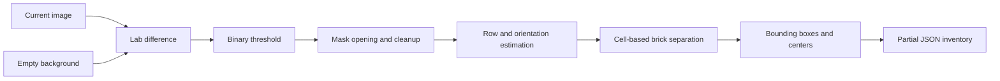

# Persona 1 — Perception

This document is a short, versioned summary of the perception work. It will be updated whenever the detector or inventory contract changes.

## Version 0.1 — Partial inventory

### Current flow

### Implemented

- The background is resized to the current image resolution; the current image is not resized.
- Brick regions are obtained from color difference in Lab space using a threshold of `40`.
- A `3 x 3` morphological opening removes small isolated noise.
- Connected components remove regions smaller than `100 px`.
- A hierarchical layout estimates vertical or horizontal rows using nominal brick dimensions.
- Local projection valleys and geometry fallback cuts separate touching bricks.
- Detection cells produce one bounding box and pixel center per brick.
- IDs are assigned and the partial inventory is exported as JSON.

### Current validation

The detector returns the expected brick count for the selected Zenodo scenes containing `2`, `6`, `10`, `17`, and `25` bricks. The shared example currently uses the 17-brick scene.

### Output for the team

- Contract: `interfaces.md`
- Shared example: `data/inventories/partial_inventory.json`
- Reproducible image subset: `data/images/zenodo_detection/`
- Diagnostic images: `outputs/` (local only)

The inventory is marked as `partial`. Bounding boxes and centers are available, while `color_group` remains `unknown` and `color_score` remains `0.0`.

### Known limitations

- The method requires an empty background image with a similar camera viewpoint.
- Separation uses approximate brick size and mostly axis-aligned orientations.
- Some internal boundaries are not yet perfectly aligned, especially in denser layouts.
- Validation currently covers only the selected dataset scenes, not the final hackathon setup.

### Next step

Improve the remaining internal cut alignment and then implement the color estimator using the detected brick regions.
