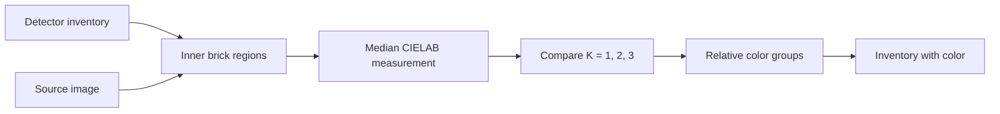
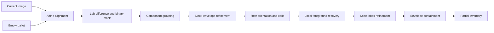

# Person 1 — Perception

Short, versioned summary of the detector and inventory delivered by Person 1.

## Color estimator v0.1 — Relative CIELAB groups

### Current flow

### Implemented

- Samples the center of each reliable detector box and excludes partial or merged detections.
- Uses median CIELAB values and within-brick lightness spread.
- Selects one, two, or three relative groups using size, Delta E, silhouette, and compactness checks.
- Preserves per-brick confidence and keeps excluded detections as `unknown`.
- Writes a new schema `0.2` inventory without overwriting detector results.

### Validation and team output

- Validated on 11 wall scenes and the 70-brick pallet scene.
- Shared pallet result: `data/inventories/inventory_with_color.json`.
- Additional test inventories: `data/inventories/color_estimation/`.
- Group names are relative to each scene; their CIELAB centers are stored in the inventory.

## Version 0.2 — Full-pallet brick geometry

### Current flow

### Implemented

- Affine ECC alignment keeps the current image resolution and aligns the empty background.
- Lab color difference, thresholding, morphological opening, and component grouping isolate the brick stack.
- A hierarchical estimator supports vertical and horizontal rows using nominal brick dimensions.
- Local recovery restores weak foreground without changing the detected grid.
- Sobel X/Y locally refines the four sides of each bounding box.
- The stack envelope removes contaminated outer regions and prevents boxes from following pallet edges.
- IDs are spatially ordered by row, from left to right.

### Validation

- Exact counts were obtained for scenes containing `2`, `6`, `10`, `17`, `22`, `25`, `32`, `37`, `51`, and `70` bricks.
- Previous regression scenes retain mean IoU values between `0.891` and `0.935` after the 0.2 changes.
- The full-pallet scene returns `70/70` detections, mean IoU `0.901`, and minimum IoU `0.700`.
- The previous-row geometry fallback was not required by any validated scene.

Validation artifacts are written to `outputs/` and remain local. Development and regression scripts are stored in `scripts/`.

### Team output

- Contract: `interfaces.md`
- Shared example: `data/inventories/partial_inventory.json`
- Reproducible images: `data/images/zenodo_detection/`

The shared inventory uses the 70-brick full-pallet scene. It remains `partial`: geometry is available, while `color_group` is `unknown` and `color_score` is `0.0`.

### Known limitations

- The method requires an empty-pallet reference with a similar camera viewpoint.
- Brick dimensions are used as layout priors, and orientations are assumed to be approximately axis-aligned.
- Final validation is still required with the hackathon camera and pallet.

### Next step

Validate detector and relative color groups with the hackathon camera, then calibrate absolute material names only if required by planning.

## Version 0.1 — Initial geometry

- Introduced Lab background difference, mask cleanup, hierarchical cells, spatial IDs, and the partial inventory contract.
- Validated progressively from 2 to 32 bricks.
