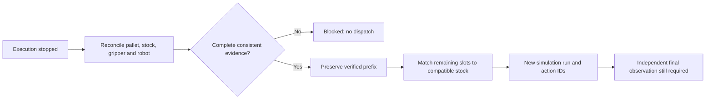

# Recuperación de pallets parciales

La recuperación agrega una observación explícita del estado completo de la
celda antes de preparar un trabajo nuevo. No convierte un timeout en éxito ni
reenvía automáticamente el comando pendiente.



## Demo reproducible

Desde la raíz del repositorio, sin ROS ni dependencias adicionales:

```bash
python3 -m integration.recovery_demo --output-dir artifacts/recovery_demo_02
```

El directorio debe ser nuevo para conservar los journals anteriores. Abrir
`index.html` muestra la propuesta y el resultado; `blocked.html` muestra el
rechazo cuando la pinza no está reconciliada. Toda la interfaz está en inglés.
Los JSON y el SQLite de ese directorio contienen evidencia sintética y auditoría.

La demo inyecta un resultado incierto en `pick` del paso 5, después de cuatro
colocaciones. Declara una reconciliación sintética con pinza vacía, robot en
posición segura, esas cuatro piezas en el pallet y una pieza faltante sustituida
por otra compatible. Conserva las cuatro posiciones, genera 64 acciones nuevas
y termina las 12 colocaciones. No usa el código ni datos de persona 1.

El ejemplo no demuestra que un sensor haya visto un pallet ni que se haya
recuperado un robot físico. La evidencia sintética prueba la lógica de decisión.

## Contrato cell-reconciliation-0.1

| Campo | Significado |
|---|---|
| run_id / plan_digest | Ejecución y plan a los que corresponde la observación. |
| basis_digest | Huella del checkpoint, job, estado y despacho pendiente actuales. Rechaza observaciones antiguas. |
| observation_id | Identificador no vacío de la reconciliación. |
| source | synthetic, perception u operator; declaración de procedencia, no autenticación del productor. |
| coverage | Debe ser complete; un subconjunto de piezas no demuestra el resto de la celda. |
| gripper | Debe ser exactamente {"state":"empty"}. Una pieza sostenida requiere intervención/reconciliación antes de continuar. |
| robot | Debe ser exactamente {"state":"safe_home"}. Es una declaración del reconciliador; este módulo no controla el movimiento de vuelta. |
| placements | Posiciones verificadas, con brick_id, color_group, layer/row/column y cara/orientación cuando el plan las modela. |
| inventory | Piezas disponibles con el contrato de atributos/caras del planificador. IDs físicos únicos, no IDs reasignados por imagen. |
| missing_ids | IDs originales explícitamente ausentes. Ningún ID original puede quedar sin explicación o aparecer en dos ubicaciones. |
| source_poses / frame / units | Poses de todas las piezas disponibles en el frame de celda y en metros. |

El comando `inspect` entrega las huellas actuales, pero **no fabrica evidencia**.
El ejemplo completo de formato está en `reconciliation.json` de la demo.

Las declaraciones empty, safe_home y complete deben proceder del mecanismo de
observación/intervención acordado para la celda. Cambiar esos textos en un JSON
no comprueba el mundo físico. Un futuro SDK debe validar su estado real antes
de autorizar una continuación del robot.

## Uso separado: revisar y continuar

```bash
python3 -m integration.recovery inspect --state PATH/state.sqlite3 \
  --run-id PARENT_RUN --output PATH/checkpoint.json

python3 -m integration.recovery assess --state PATH/state.sqlite3 \
  --run-id PARENT_RUN --observations PATH/reconciliation.json \
  --output PATH/proposal.json

python3 -m integration.recovery continue --state PATH/state.sqlite3 \
  --run-id PARENT_RUN --observations PATH/reconciliation.json \
  --proposal-digest SHA_FROM_PROPOSAL --output PATH/continuation.json
```

`assess` no despacha acciones y produce HTML junto al JSON. Retorna 3 si queda
bloqueado; los errores de formato/binding retornan 2. `continue` vuelve a calcular
la propuesta bajo una transacción y compara su huella con la revisada antes de
transferir el ciclo. Solo admite el backend acknowledgement_simulator, tanto
en el padre como en el hijo. Rechaza hardware y panda_moveit_kinematic.

## Qué conserva y qué recalcula

- Las posiciones preservadas deben formar un prefijo exacto del orden
  capa-fila-columna. Todas las posiciones antes confirmadas deben seguir allí,
  con los mismos IDs, tonos y caras/orientaciones declaradas.
- Puede reconocer como colocado el siguiente ladrillo cuyo resultado era
  incierto, si la observación completa confirma su posición. No vuelve a recogerlo.
- Mantiene la receta y las categorías de cada posición. Conserva primero las
  asignaciones pendientes compatibles y busca sustitutos con el mismo tono.
  El matching puede usar distintas caras observadas; nunca inventa una cara.
- Si faltan existencias compatibles, hay huecos en el prefijo, cambios en lo
  colocado, poses superpuestas o evidencia incompleta, bloquea el trabajo.
- El robot debe estar reconciliado en posición segura y sin pieza agarrada.
  No calcula una maniobra automática para soltar o recuperar una pieza incierta.

No se modifica la receta para disimular un faltante ni se optimiza de nuevo el
patrón global. Un pallet fuera de orden, un cambio de receta o una pieza ya
colocada que haya cambiado requieren otra intervención/propuesta.

## Persistencia y límites

La transacción crea un run hijo con nuevos IDs de acciones, transfiere el ciclo
y las reservas seleccionadas y marca el padre superseded. Conserva el checkpoint,
el despacho pendiente y la observación/propuesta originales. Las reservas de
IDs ausentes no se liberan silenciosamente. La transferencia no implementa una
cola de producción, un reset físico de pallet ni exclusión entre varias celdas.

Se comprueba la propiedad del ciclo antes del despacho y antes de guardar su
resultado. Un reconocimiento tardío de un ejecutor sustituido no puede reactivar
el padre ni cambiar el run hijo. Los despachos físicos en curso no se cancelan
mediante esta transacción: por eso no se habilita recuperación de hardware.

El resultado nuevo mantiene final_validation=awaiting_observation hasta aportar
una validación final independiente vinculada al run hijo y a su plan. La
reconciliación inicial no se reutiliza como prueba de que las tareas restantes
salieron bien.

Pruebas específicas: conservación del prefijo, reconocimiento de colocación
incierta, sustitución, asignación con caras alternativas, evidencia obsoleta,
poses superpuestas, rechazo de replay, resultado tardío, pallet ya completo,
bloqueo de backend robótico y CLI.

## Verificación de esta entrega

Pasaron 61 tests del núcleo (11 de recuperación), 10 de transporte ROS y 4 del
adaptador Panda. El test ROS durable conserva todas sus condiciones y admite
hasta 30 s para completar la secuencia de 96 acciones con commits persistentes;
el límite anterior de 10 s se agotó con progreso activo en esta máquina. Los
tests en memoria mantienen su límite original. No se reduce la durabilidad ni
se omiten las comprobaciones del journal para acelerar la demo.
