# Roadmap visual — Munich Hackathon 2026
## Reto Marmon #8 — Intelligent Brick Blending and Palletizing

> **Objetivo de este documento**: presentar un roadmap **más simple, visual y accionable** para un equipo de **3 personas**, usando **grafos de nodos** para entender rápidamente:
>
> 1. cuál es la propuesta de solución,
> 2. qué módulos existen,
> 3. qué le corresponde a cada persona,
> 4. cómo se integra todo antes y durante la hackathon.

---

## 1) Idea general de la solución

La propuesta busca resolver el reto con la **menor complejidad posible** y con una arquitectura **modular**.

La idea es dividir la solución en **3 grandes bloques**:

- **Percepción**: ver los ladrillos y describirlos.
- **Planificación**: decidir cómo mezclarlos y en qué orden colocarlos.
- **Integración / ejecución**: conectar la lógica con una simulación y, luego, con el hardware real.

La solución se diseña primero como **modelo conceptual** y luego como **prototipo adaptable** al hardware que entreguen en Múnich.

---

## 2) Modelo conceptual (independiente del hardware)

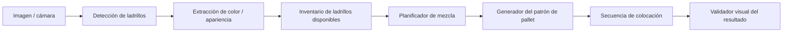

### Lectura rápida
- **Detección de ladrillos**: ubica cada ladrillo visible.
- **Extracción de color / apariencia**: estima el tono o categoría visual.
- **Inventario**: mantiene la lista de ladrillos disponibles.
- **Planificador de mezcla**: decide qué combinación conviene.
- **Patrón de pallet**: define cómo debería verse el paquete final.
- **Secuencia de colocación**: define el orden de pick/place.
- **Validador**: comprueba si el resultado final cumple la intención visual.

---

## 3) Prototipo real (adaptable al hardware)

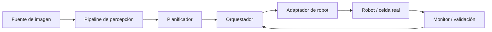

### Idea clave
El sistema debe funcionar aunque cambie el robot.

Por eso se separa:
- **lógica propia del reto** → percepción, mezcla, secuenciación;
- **dependencia del hardware** → adaptador del robot.

Si el hardware cambia el día del evento, solo se ajusta el nodo **Adaptador de robot** y parte del **Orquestador**, no toda la solución.

---

## 4) Grafo principal de nodos

Este es el grafo base recomendado para el repositorio.

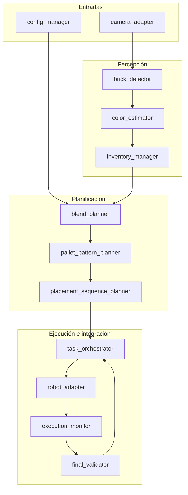

---

## 5) Reparto del trabajo — equipo de 3 personas

La división debe permitir que cada integrante trabaje en su rama con independencia y luego se integre por etapas.

---

## Persona 1 — Percepción

### Responsabilidad
Ver los ladrillos, identificar sus atributos visuales y construir el inventario.

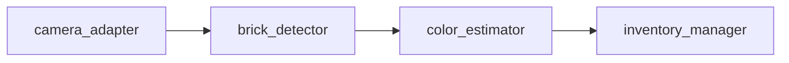

### Nodos a su cargo
- `camera_adapter`
- `brick_detector`
- `color_estimator`
- `inventory_manager`

### Entregables
- lectura de imagen o dataset;
- detección simple de ladrillos;
- estimación de color o clase visual;
- salida estructurada del inventario.

### Salida esperada
Ejemplo conceptual:

```text
[
  {id: 1, color_group: "dark", score: 0.82},
  {id: 2, color_group: "medium", score: 0.74},
  {id: 3, color_group: "light", score: 0.90}
]
```

### Objetivo mínimo
No hace falta IA compleja.

Basta con una primera versión basada en:
- segmentación simple,
- bounding boxes,
- promedio de color,
- agrupación por rangos de tono.

---

## Persona 2 — Planificación

### Responsabilidad
Decidir cómo mezclar los ladrillos y en qué orden se colocan.

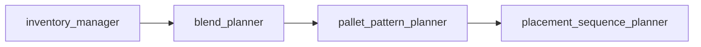

### Nodos a su cargo
- `blend_planner`
- `pallet_pattern_planner`
- `placement_sequence_planner`

### Entregables
- reglas de mezcla visual;
- patrón objetivo del pallet;
- secuencia de colocación.

### Salida esperada
Ejemplo conceptual:

```text
posición_1 -> brick_3
posición_2 -> brick_1
posición_3 -> brick_7
...
```

### Objetivo mínimo
Usar una estrategia sencilla y robusta:
- dividir ladrillos por grupos de color;
- imponer equilibrio por filas o capas;
- evitar acumulaciones del mismo tono en zonas contiguas;
- generar una secuencia fácil de ejecutar.

No conviene empezar con optimización compleja.

---

## Persona 3 — Integración, simulación y ejecución

### Responsabilidad
Unir percepción y planificación, ejecutar la secuencia y preparar la adaptación al hardware.

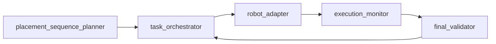

### Nodos a su cargo
- `task_orchestrator`
- `robot_adapter`
- `execution_monitor`
- `final_validator`
- scripts de simulación / pruebas / demo

### Entregables
- integración de módulos;
- simulación del proceso;
- adaptador al robot real cuando se conozca;
- validación final y logging.

### Objetivo mínimo
Antes de la hackathon, este integrante debe garantizar que:
- el flujo completo corre sin hardware real;
- existe una demo reproducible;
- se puede cambiar de simulación a hardware sin reescribir el sistema entero.

---

## 6) Grafo de integración por personas

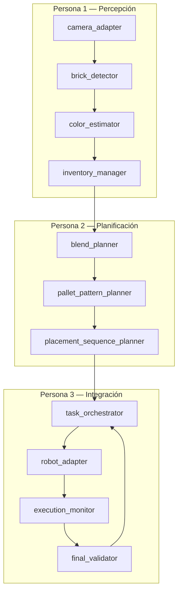

### Qué significa
- **Persona 1** entrega un inventario confiable.
- **Persona 2** usa ese inventario para decidir el patrón y la secuencia.
- **Persona 3** ejecuta la secuencia y valida el resultado.

---

## 7) Roadmap simple por fases

---

## Fase 0 — Preparación base (antes de desarrollar)

### Meta
Dejar todo listo para trabajar en paralelo sin bloquearse.

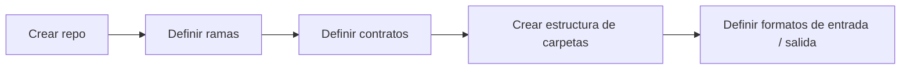

### Tareas
- crear el repositorio;
- crear ramas individuales;
- acordar nombres de módulos y formatos de intercambio;
- crear documentación mínima por rama;
- definir un pequeño dataset de prueba.

### Resultado esperado
Cada persona puede trabajar sin romper el trabajo de las demás.

---

## Fase 1 — Desarrollo individual de módulos

### Meta
Cada persona desarrolla su bloque principal.

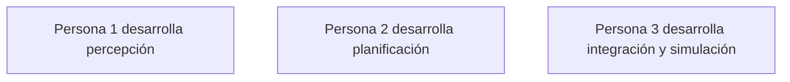

### Resultado esperado
- percepción funcional;
- planificación funcional;
- simulación / orquestación básica lista.

---

## Fase 2 — Primera integración

### Meta
Conectar los tres bloques en una demo simple.

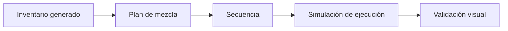

### Resultado esperado
Demo software end-to-end, aunque todavía sin robot real.

---

## Fase 3 — Robustez y simplificación

### Meta
Reducir fragilidad y dejar una versión clara para presentar.

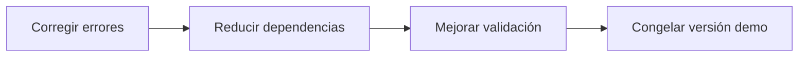

### Resultado esperado
Versión estable para llevar a la hackathon.

---

## Fase 4 — Adaptación durante la hackathon

### Meta
Conectar el sistema al hardware real con el mínimo cambio posible.

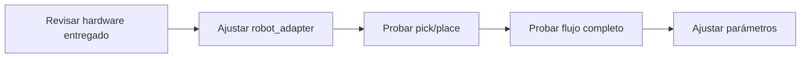

### Resultado esperado
Prototipo funcional sobre la plataforma real, manteniendo el mismo flujo lógico.

---

## 8) Qué debe hacer cada persona antes de la hackathon

## Persona 1
- preparar dataset o imágenes de prueba;
- implementar detección básica;
- implementar clasificación simple por color;
- exportar inventario en formato acordado.

## Persona 2
- definir criterios de mezcla;
- diseñar el patrón del pallet;
- generar secuencia de colocación a partir del inventario.

## Persona 3
- estructurar el repositorio;
- implementar simulación ligera del flujo;
- integrar módulos 1 y 2;
- preparar scripts de demo y validación.

---

## 9) Qué puede cambiar el día de la hackathon

Esto debe quedar explícitamente separado.

### Fijo desde antes
- idea de solución;
- módulos de percepción;
- lógica de mezcla;
- secuencia de colocación;
- estructura del repositorio;
- contratos entre nodos.

### Adaptable el día del evento
- tipo de robot;
- API del robot;
- tipo de cámara;
- resolución de imagen;
- sistema de agarre;
- tiempos reales de pick/place;
- layout de trabajo.

---

## 10) Propuesta de estructura del repositorio

```text
marmon-hackathon-2026/
├── README.md
├── roadmap_graph.md
├── interfaces.md
├── docs/
│   ├── person_1_notes.md
│   ├── person_2_notes.md
│   └── person_3_notes.md
├── data/
├── perception/
│   ├── camera_adapter/
│   ├── brick_detector/
│   ├── color_estimator/
│   └── inventory_manager/
├── planning/
│   ├── blend_planner/
│   ├── pallet_pattern_planner/
│   └── placement_sequence_planner/
├── integration/
│   ├── task_orchestrator/
│   ├── robot_adapter/
│   ├── execution_monitor/
│   └── final_validator/
└── scripts/
```

---

## 11) Flujo de ramas recomendado

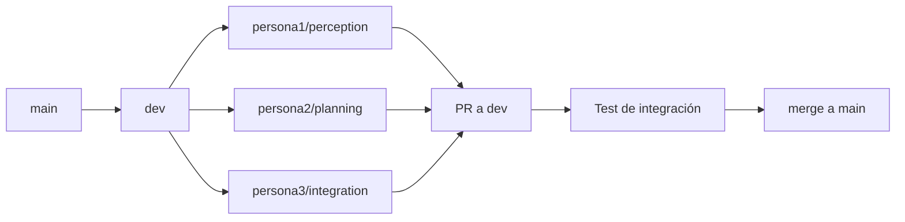

### Reglas simples
- cada persona trabaja en su rama;
- nadie programa directamente sobre `main`;
- las integraciones van primero a `dev`;
- cada PR debe actualizar su documentación mínima;
- si una salida cambia, se actualiza `interfaces.md`.

---

## 12) Entregables mínimos por persona

| Persona | Entregable mínimo | Debe producir |
|---|---|---|
| Persona 1 | Percepción funcional | inventario de ladrillos |
| Persona 2 | Planificación funcional | patrón + secuencia |
| Persona 3 | Integración funcional | demo end-to-end |

---

## 13) MVP recomendado

El **MVP** para llegar bien a Múnich no debe intentar resolver todo desde el inicio.

### MVP sugerido
1. usar imágenes de prueba;
2. detectar ladrillos y agruparlos por color;
3. generar una mezcla equilibrada simple;
4. producir una secuencia de colocación;
5. simular el resultado final;
6. dejar el `robot_adapter` preparado para el día del evento.

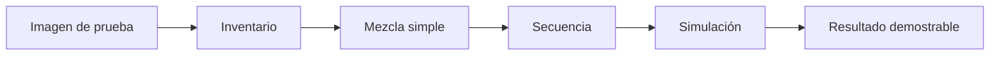

---

## 14) Priorización recomendada

### P0 — imprescindible
- estructura de repo;
- contratos entre módulos;
- percepción básica;
- planificación básica;
- integración básica;
- demo end-to-end sin hardware.

### P1 — importante
- mejora de precisión de color;
- mejor simulación;
- validador visual más fuerte;
- métricas de calidad del blend.

### P2 — opcional
- optimización avanzada;
- IA más compleja;
- interfaz gráfica elaborada;
- estrategias avanzadas de reordenamiento.

---

## 15) Resumen ejecutivo

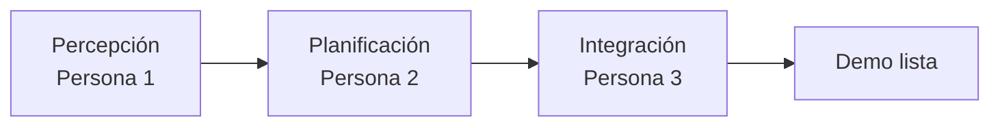

### Idea final
La solución debe ser:
- **simple**,
- **modular**,
- **entendible**,
- **fácil de integrar**,
- **fácil de adaptar al hardware real**.

La prioridad no es construir la solución más compleja, sino la más **factible y demostrable**.

---

## 16) Próximo documento recomendado

Después de este roadmap visual, el siguiente archivo a generar debería ser:

- **`interfaces.md`** → definiendo exactamente qué entra y qué sale de cada nodo;
- o bien **`README.md`** → con instrucciones para clonar, ramas y ejecutar la demo base.

