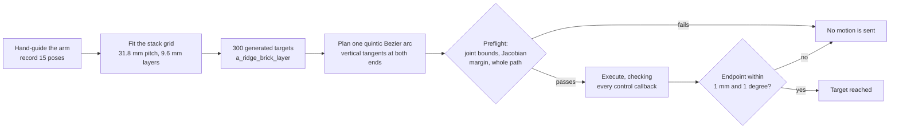

# Task 2 — Franka manipulation

**Teaching a robot arm to pick a brick and stack it, without ever guessing where anything is.**

A Franka Research 3 arm has to take bricks from an input stack and build an output pallet. The
difficulty is not the motion itself: it is that a 1 mm error in a position you *inferred* becomes a
collision, a dropped brick, or a layer that will not sit flat. So this task is built on one rule:
**every target is either measured by hand on the real robot, or derived from measured anchors on a
fitted grid.** Nothing is invented.

There are two code bases here, built in parallel for the same cell.

| Folder | What it is | Start here |
|---|---|---|
| [`teaching-baseline/`](teaching-baseline/) | The direct approach: taught positions, a fitted grid of 300 targets, and one continuous arc between them. Talks to the robot over libfranka. | [teaching-baseline/README.md](teaching-baseline/README.md) |
| [`ros2-stack/`](ros2-stack/) | The ROS 2 Humble approach: hand-eye calibration, color perception, a pallet occupancy registry and MoveIt motion. | [ros2-stack/README.md](ros2-stack/README.md) |

## The idea in one page

Teach the robot a handful of real positions by hand-guiding it and recording the pose. Fit a grid
through those anchors to generate the remaining hundreds of brick positions. Then move between them
along a single continuous curve, and **stop the moment reality disagrees with the plan**.

The grid that was fitted through the taught anchors differs from them by at most **0.89 mm in XY and
1.14 mm in Z**. That residual is reported rather than smoothed away, because it is the honest
uncertainty in every generated target.

## What makes it stop

Motion is refused or aborted on any of these, and this list is the real substance of the task:

- endpoint error above **1 mm** or **1 degree**
- a control callback gap above 20 ms, which means the real-time loop slipped
- joint bounds, or a scaled Jacobian margin that means the arm is near a singularity
- a stale starting posture, a stale robot model, or a changed tool frame
- a path the planner cannot certify across its whole length, not just at the endpoints

When preflight blocks a route, **nothing is sent to the robot**. The fix is to hand-guide to a better
posture or find a different clearance path, never to lower the margin until it passes.

## What was actually achieved, and what was not

Confirmed on the real robot:

- All **30 upper-layer poses** traversed in one sequence, ending at the far corner.
- **315 / 315** targets have at least one model-feasible joint configuration.
- Two corner bricks picked, carried and released, with camera-verified delivery. Contact stopped near
  **15.2 mm** against a nominal 15.8 mm brick.
- A 15 mm grasp descent with **0.592 mm** endpoint error; a 1 mm jog with **0.753 mm**.

Not achieved:

- **Full sorting was never demonstrated.** Individual grasps worked; a complete run did not.
- Model feasibility is not physical reachability: cable, camera and whole-arm clearance still need
  checking for any new joint configuration.
- A passing endpoint does not prove a path exists from an arbitrary start.
- In the ROS 2 stack, the operator moved the supports mid-event, which invalidated every previous
  world registration. Those coordinates were deliberately **not** reused.

That last point is worth keeping: when the scene changed, the stack refused to reuse its old
calibration rather than quietly carry on with coordinates that no longer meant anything.

## Safety note

`teaching-baseline/quick_test/run.sh --execute` and any command with `--execute` **move a real
robot arm**. Clear the tool and arm links, keep the physical stop within reach, and read the
subfolder README before running anything. Robot faults need operator inspection and Desk recovery;
none of these tools clears a fault automatically.

---

Written by **ns-235861**. See [../AUTHORS.md](../AUTHORS.md).

Runtime evidence (captures, trajectory plans, commissioning logs) stays in the team's private
repository; the code, configuration and measured conclusions are here.
