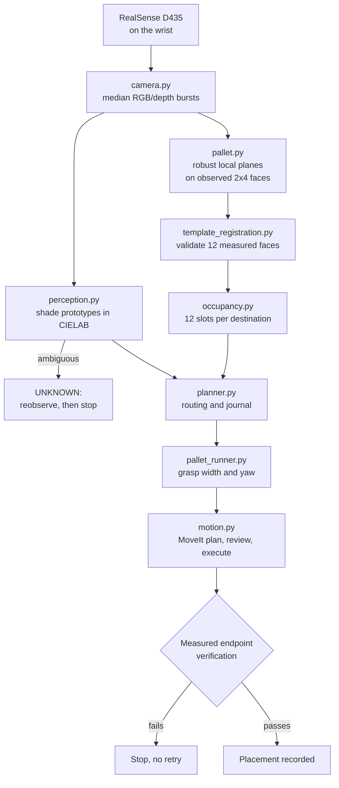

# ROS 2 stack — perception, calibration and palletizing

The ROS 2 Humble approach to task 2, for the Franka Research 3 with the stock Franka Hand: see the
bricks with a wrist camera, work out where they are in the robot's own coordinates, and place them
into measured pallet slots.

**Physical sorting was not demonstrated.** One isolated brick was grasped and lifted with
source-removal evidence, but its placement was parallel to the reference instead of the required
90-degree first-layer pattern, so it does not count as a successful placement. Both sorting request
modes remain unproven. The code, the calibration machinery and the measured evidence are what this
folder delivers.

## Contents

| Package | What it does |
|---|---|
| [`franka_lego_sorter/`](franka_lego_sorter/) | The application: color perception, pallet registration, occupancy, routing and motion. [Full reference](franka_lego_sorter/README.md). |
| [`franka_realsense_handeye_ros2/`](franka_realsense_handeye_ros2/) | Hand-eye calibration from ChArUco observations, as a ROS 2 package with its own launch file and test. |
| [`ros2_stack_reference/`](ros2_stack_reference/) | A reference stack organized into numbered blocks, each with its own `ALGORITHM_AND_DECISIONS.md` explaining what was chosen and why. |

## The chain from pixel to placement

Two things in that chain matter more than the rest:

**The hand-eye transform is treated as unproven until it is proven.** Three earlier captures were
near-translation-only, which cannot determine a hand-eye transform at all, and
`scene_handeye_rejected.yaml` records that rejection instead of burying it. The current candidate is
numerically accepted and physically unverified, and the code says so.

**A verdict of "I don't know" is a stop, not a guess.** An ambiguous shade is reobserved and then
causes a recoverable stop. It is never silently rejected or routed anywhere.

## Routing

Relative to the input pallet: the requested output goes right, both scrap colors go to the tray on the
left, and unused good colors go to separate upper and lower pallets.

| Color ID | Routing |
|---|---|
| `300121`, `6117418`, `6487946` | Good; requested colors go right, the others upper/lower |
| `6135191`, `4211201` | Scrap tray, only when confidently identified |

Set `job.requested_colors` to one or two good IDs. `requested_count` is the total quantity for the
requested pallet, not a per-color quota; mixtures accept requested colors in arrival order, and the
journal reports the actual composition. Each good destination has **12 independently measured
positions: four parallel ridges of three bricks**, all filled before the next layer starts. Pallet
spacing comes from the physical template, gaps and staggering included; no solid rectangular grid is
substituted for it.

## Hardware as actually identified

- Camera: **RealSense D435, serial `943222073921`** — not a D435i. Depth is aligned to color; use
  `T_tcp_color` with these pixels.
- Logitech C920 overview camera was at `/dev/video8`; rerun `v4l2-ctl --list-devices` if the numbering
  changes.
- Robot IP `172.16.0.2`, ROS base `fr3_link0`, TCP `fr3_hand_tcp`, group `fr3_arm`.
- ROS domain **31**, set through `LEGO_ROS_DOMAIN_ID`, because this machine carries an unrelated
  inherited `ROS_DOMAIN_ID=23`.
- Desk selects the standard **Hand**: flange to TCP is `Rz(-45°)` and 103.4 mm in Z, matching stock
  ROS forward kinematics. The historical custom Desk TCP at 174 mm needed a 70.6 mm correction —
  **do not apply that obsolete correction to current standard-Hand data.**
- The standard-Hand model is 0.73 kg with zero additional load. That does not measure the wrist camera
  and bracket inertia, and no payload value should be invented from it.

## The scene change, and why old coordinates were discarded

Partway through, the operator added support floorboards and may have repositioned the source or the
output assembly. `data/current_scene_state.json` records that this invalidated **all** previous source
and template world registrations, support heights, derived placement and recovery targets, and old
motion plans.

Historical artifacts are kept for review, but a trajectory that passed review earlier does not make
its coordinates reusable. No old source pixel is a current world coordinate. Recovering needs fresh
paired RGBD with actual TCP poses, re-registration of the current 12 footprints, and new measurements
of the board, table and support heights. Manual polygons are hash-bound to the capture they were drawn
on and cannot be copied onto a changed image.

A close RGB image taken from the old low approach can document that new objects exist, but it does not
establish valid depth or support geometry.

## A measurement worth keeping

After the Hand was reconnected, a slow upward step reached a settled pose but **failed strict endpoint
verification at about 2.3 mm**, so the automatic steps stopped. The controller itself had reported
trajectory success.

That is the whole argument for verifying measured poses separately from what the controller claims.

---

Written by **ns-235861**. See [../../AUTHORS.md](../../AUTHORS.md).

Runtime evidence under `data/commissioning/` (captures, trajectory plans, independent FK reviews,
hardware probes) is excluded from git. The existence of a tool here does not mean the camera model,
the templates or the station geometry were commissioned.

**On links that do not resolve:** documents in this folder, and especially the index under
`ros2_stack_reference/blocks/`, link to two things that are not in this public copy: the vendored
upstream ROS 2 workspace (`sources/`, which is `franka_ros2` and `libfranka` from Franka Robotics,
better obtained from upstream) and the runtime evidence above. The text describing each decision is
intact; only those targets are absent.
