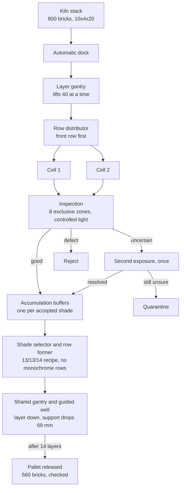

# Task 3 — Factory simulation

**If a factory sorted and stacked reclaimed bricks without people, how fast would it actually run?**

This is an offline model of the whole production line: bricks arrive from the kiln, every one is
inspected, the good ones are blended by shade into balanced layers, and the layers are stacked into
pallets. It runs as a simulation and replays in a browser, so you can watch the line work and read
the numbers it produced.

No server, no GPU and no extra packages are needed to watch it.

## Open the delivered model

From this folder, with Python 3.10 or newer:

```bash
python3 scripts/open_cart37_checkpoint.py
```

Then open `artifacts/greenfield_37/index.html` in a WebGL browser. Allow about 250 MB for the
extraction; it refuses to overwrite an existing file.

Verify the recorded run:

```bash
python3 scripts/verify_cart37_checkpoint.py task3_checkpoint/greenfield_37/combined-ccaf03c52e40aaca.json.gz
```

The validator checks material conservation, pallet identity, mixed recipes in three dimensions,
category-specific orders, rejection interlocks and synchronized layer transfers.

> The recorded replay packages and the Unreal content are large, so they are **not** in this
> repository. `scripts/open_cart37_checkpoint.py` and the team's private repository hold them.
> Everything that generates, validates and renders them is here.

## How the line is put together



Three decisions shape the whole model:

- **Nothing is inspected by a person.** Uncertainty gets one automatic second look, then quarantine.
  The line never waits for a human verdict.
- **SimPy owns the clock and the resources; the browser only replays.** Three.js draws the exact
  positions SimPy produced, per brick ID. There is no separate visual animation that could disagree
  with the numbers.
- **A shared mechanism is a real constraint.** Depositing a brick and recovering one use the same
  transfer mechanism, so they cannot happen at once. That shows up as a measured bottleneck rather
  than being hidden.

## What it measures, and what the numbers mean

The reference four-cell run reaches about **1,337 conforming bricks per hour**, against a configurable
goal of 3,000. That gap is the useful result: it points at the shared divert mechanism as the
constraint to fix, instead of claiming a target was met.

| Scenario | Outcome | Conforming released/h |
|---|---|---:|
| Autonomous reference | completed with residual stock | 1337.38 |
| More uncertain observations | completed with residual stock | 1702.76 |
| One cell isolated before dispatch | completed with residual stock | 1107.77 |
| High rejection | completed with residual stock | 781.22 |
| Two-cell alternative | completed with residual stock | 779.52 |
| Alignment outside recovery range | safe hold | censored, not comparable |
| Missing source confirmation | safe hold | censored, not comparable |

Note the trap in row two: **more uncertainty looks faster.** It sends more bricks to quarantine, so
there is less work left to do. Throughput alone is misleading, which is why rejection, quarantine,
formed material and retained stock are always reported together.

Runs that stop in a safe hold are censored, not averaged in as if they were capacity.

## What this is not

The model is a **verifiable candidate, not a demonstrated optimum**, and it is not a validated
factory design:

- Color and quality identification inside the simulation is **synthetic**. It does not run task 1's
  perception on rendered images. Real error rates need task 1's measurements.
- Grasp and end-stop confirmations are assumed virtual signals. There is no PLC and no hardware.
- Brick envelopes are checked at sampled positions. That is **not** a continuous collision proof, and
  it excludes tools, cables, contact, friction, tipping and structural integrity.
- Speeds and dwell times are engineering assumptions from vendor datasheets, not measured cycles.
- There is no measured manual baseline, no quoted CAPEX and no demonstrated ROI.

Each assumption, with its source URL, ships inside every run report under **Engineering basis**.

## Where things are

| Folder | What is in it |
|---|---|
| `greenfield/` | The delivered model and the browser viewer |
| `plant_sim/` | The earlier SimPy line model, kept intact as the prototype it grew from |
| `planning/` | Blend selection, pattern and sequencing: the logical plan |
| `execution/` | Turns a plan into transport-independent object actions |
| `integration/` | Cell journal, reservations, evidence and explicit recovery |
| `arm_bridge/`, `ros_bridge/` | Optional Panda / MoveIt and ROS 2 adapters |
| `cinematic/`, `unreal/` | Rendering and the native Unreal exploration |
| `scripts/` | Checkpoint extraction, validation, demo generation |
| `tests*/` | Validation per subsystem |
| `config/`, `examples/`, `data/` | Configurations and reproducible inputs |

### Documents worth reading

| Document | Why |
|---|---|
| [docs/greenfield.md](docs/greenfield.md) | The full concept: every station, every assumption, every source |
| [interfaces.md](interfaces.md) | The data contract between the tasks, from plan to execution |
| [docs/mixing_criteria.md](docs/mixing_criteria.md) | How bricks are blended, and why "soft" is still a hypothesis |
| [docs/faces.md](docs/faces.md) | Per-face shade: a brick is a different color on each side |
| [TASK3_README.md](TASK3_README.md) | The delivered revision 37 package, in detail |
| [docs/greenfield37_performance_methodology.md](docs/greenfield37_performance_methodology.md) | Exactly how the throughput figures were computed |
| [docs/greenfield37_hardware_budget.md](docs/greenfield37_hardware_budget.md) | Installed-budget planning, around 2.70 M EUR |

The numbered documents in `docs/` (`*_15` to `*_27`) are the revision log: what changed at each
step and what it fixed.

## Curation note

This folder is a filtered copy of the team's working branch. Internal coordination notes, dated
review logs and recorded artifacts were left out of this public release, which is why some revision
documents refer to material you will not find here. The code, the contracts, the validators and the
measured results are complete.

Written by **JhannoxDev**. See [../AUTHORS.md](../AUTHORS.md).
